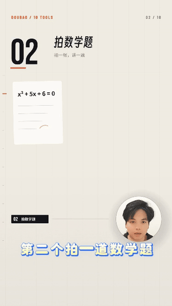

# B-roll

**Turn a talking-head recording into a designed film.** Footage + complete SRT + one brief → vertical MP4 + editable Three.js project.

[简体中文](README.zh-CN.md) · **English**

  
  

Chapter 02 Math homework (avatar right)　·　Chapter 08 Comparing three products (avatar left)

## What it looks like

A 100-second "ten things Doubao can do" talking-head film, produced end to end:

- **1080×1920 vertical, 30 fps** — every sentence becomes a chapter, with its own number, title, parameters, process and payoff instead of one face talking for the whole runtime.
- **The speaker is matted into a small circular window** — no full-frame face; the window swaps left/right every two chapters, and the bottom 20% of the frame stays empty so platform UI never covers the face or the type.
- **Layouts build in layers** — conditions first, process unfolds, result lands, and cuts sit on musical downbeats rather than popping in as blocks.
- **Hand-offs stay continuous** — horizontal wipes, vertical pushes and hard cuts are assigned by rhythm, so the avatar and label bar move exactly at the cut and the eye never loses its place.
- **The project stays editable** — Three.js source, timeline JSON and render scripts ship with the film; change anything and re-render.

▶ With sound: [chapter 02](docs/media/mw-demo-right.mp4) · [chapter 08](docs/media/mw-demo-left.mp4)

## How to use it

### 1. Start

Double-click `mw-start.bat` on Windows or `mw-start.command` on macOS.

### 2. Hand over the material

Put the footage and its complete SRT into `inputs/`, open the whole folder in WorkBuddy, and send:

> Read AGENTS.md, follow the install guide as needed, then read the two project Skills. Take `inputs/source.mp4` and `inputs/source.srt` and produce a motion-designed talking-head film: build the person layer first, synced to the original, then move on to composition, keeping the original speaking order and timing. Work in `work/my-first-film/`, check the real picture and sound at every stage, and deliver the MP4 plus the editable project.

### 3. Collect the result

The finished MP4 and its preview are ordinary local files — open them directly, no server needed. Output lives in `work/<film>/`: `render/film.mp4` is the film, `film/` is the project source. `node mw-serve.mjs` is only for browsing pages under `work/` in a browser.

## Layout

| Path | Contents |
|---|---|
| `.agents/skills/srt-brief/` | Analysis Skill: reads the SRT, splits it into chapters, writes `PLAN.md` + `timeline.json` |
| `.agents/skills/motion-forge/` | Production Skill: rules and tools for motion, typography, sound and rendering |
| `scripts/` | Install, diagnostics, matting, frame capture, package checks |
| `reference-library/` | 43 case breakdowns + 10 open-source typefaces |

MIT licensed. Third-party components (Three.js, playwright-core, FFmpeg, the RVM matting model, the bundled fonts) keep their own upstream licences.
