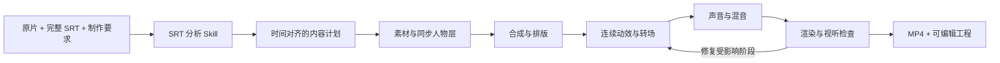

# Architecture / 项目结构

这是一个由智能体操作的三维动效生产工作区。智能体读取完整 SRT、构思影片、编写场景与渲染代码，并检查结果。仓库提供制作规则、分阶段读取器、取景与转场辅助函数和本地运行时工具；它不提供「把任意视频变成成片」的一键命令。

五个制作阶段由同一条上下文贯穿完成，不拆给多个互不通气的执行者。

| 路径 | 作用 |
| --- | --- |
| `AGENTS.md` | 把任务路由到两个项目本地 Skill |
| `.agents/skills/srt-brief/` | 完整 SRT 解读、时序与交接 |
| `.agents/skills/motion-forge/` | 素材、合成、动效、声音、检查与数学辅助 |
| `scripts/` | 跨平台安装、诊断、读取与校验 |
| `mw-serve.mjs` | 可选的本地预览 HTTP 服务 |
| `reference-library/analysis/` | 已发布的文字 / JSON 研究参数与结论；不含原片或抽帧 |
| `reference-library/typography/` | 可复用的开源字体、许可与原创样张 |
| `inputs/` | 用户素材；被 Git 忽略 |
| `work/<task>/` | 单部影片的分析、场景、素材与渲染产物；被忽略 |

实际依赖为 Three.js、Playwright / Chromium、Python 与 FFmpeg。运行时不包含 SwayJS 包或服务，也不需要任何账号型云服务。

## 当前制作基线

现行规则区分抠像与描边：保留原背景时不描人物边，更换人物身后背景才描边；人物卡片需要可见的空间层次与二次取景；字体需在真实构图里比较。容器化、安全区与动效模式的具体做法维护在 `motion-forge` 的参考文档中。
